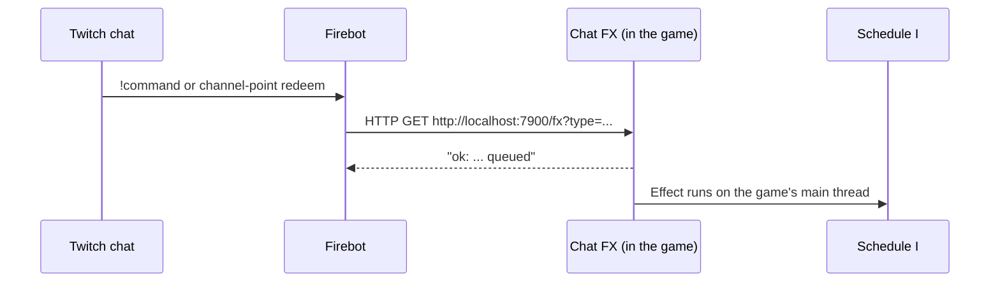

# Chat FX

A stream-interaction mod for [Schedule I](https://store.steampowered.com/app/3164500/Schedule_I/). It opens a small local web endpoint inside the game so [Firebot](https://firebot.app/) chat commands and channel-point redeems can help or hurt the players.

Built for the default (IL2CPP) branch of the game with MelonLoader.

## How it fits together



The listener thread only validates the request and queues it. The game itself is only touched from the main thread on the next frame, which is what keeps it stable.

## Effects

Call `http://localhost:7900/fx?type=<type>` with the optional parameters below. Every hurt has a matching help.

### Helps

| `type` (aliases) | Parameters | Effect | Default |
|---|---|---|---|
| `help` (`bank`, `deposit`) | `amount` | Adds money to the bank balance. | $100 |
| `cashgift` (`tip`) | `amount` | Adds cash on hand. | $100 |
| `pardon` (`clearwanted`) | `target` | Clears the wanted level. | self |
| `gift` (`resupply`) | `amount` | Gives more of a product the player is already holding. | 10 |
| `restock` (`supplydrop`) | `property`, `amount` | Adds more of a product already stored at that property. | 20 |

### Hurts

| `type` (aliases) | Parameters | Effect | Default |
|---|---|---|---|
| `arrest` (`hurt`) | `level`, `target` | Sets a police pursuit. `level` is `investigating`, `arresting`, `nonlethal` or `lethal`. | `arresting`, self |
| `pickpocket` (`steal`) | `amount` | Takes a random amount of cash on hand, up to the cap. | up to $100 |
| `hack` (`hacker`) | `amount` | Takes a random amount from the bank, up to the cap. | up to $500 |
| `rivalgang` (`gang`) | `amount` | Takes product from the player's inventory, random stack. | up to 10 |
| `raid` (`gangraid`) | `property`, `amount` | Takes product from that property's storage. | up to 20 |

### Parameters

- `amount`: a number. Its meaning depends on the effect (dollars or item count).
- `property`: part of a property's name or code, for example `bungalow` or `barn`.
- `target`: who a per-player effect hits.

| `target` | Who |
|---|---|
| empty, `self`, `me` | the player running the mod |
| `all`, `everyone` | every player in the session |
| `others` | everyone except the player running the mod |
| anything else | players whose name contains that text |

Examples:

```
http://localhost:7900/fx?type=help&amount=250
http://localhost:7900/fx?type=arrest&level=nonlethal&target=all
http://localhost:7900/fx?type=raid&property=bungalow&amount=15
```

## Firebot setup

1. In Firebot, create a command or channel reward.
2. Add the effect **HTTP Request**, method `GET`, with one of the URLs above.
3. Use Firebot variables for the parts you want viewers to control, for example `...&amount=$arg[1]`.

Firebot and the game must run on the same PC, since the endpoint only listens on `localhost`.

## Install

1. Install [MelonLoader](https://melonwiki.xyz/) 0.7.x into Schedule I and start the game once.
2. Build the mod (see below) or take a built `ChatFx.dll`.
3. Copy it into `Schedule I\Mods\`.
4. Start the game. The console prints `Chat FX listening on http://localhost:7900/fx`.

## Settings

`Schedule I\UserData\MelonPreferences.cfg`, section `[ChatFx]`.

| Setting | Default | Meaning |
|---|---|---|
| `Port` | `7900` | Local port Firebot calls. |

## Things to know

- **Run it on the host.** Game state is host-authoritative, so effects are reliable when the streamer hosts the session. Money is a shared pool, so bank and cash effects reach everyone.
- **Per-player targeting on other players** (`target=others`, a name) is wired for `arrest` and `pardon`. It has had limited testing with more than one person.
- **`gift` and `restock` copy something that already exists.** They need at least one product stack in the inventory or at the property to copy from.
- The endpoint has no authentication. It only listens on `localhost`; do not expose the port.

## Build

Requirements: .NET SDK 6 or newer, Schedule I with MelonLoader installed and started once.

```
dotnet build -c Release
```

The project references the game's assemblies from `C:\Program Files (x86)\Steam\steamapps\common\Schedule I`; change `GamePath` in `ChatFx.csproj` if your game is installed elsewhere.

Tested on game version 0.4.7f12.

## Related mods

- [schedule1-supply-run](https://github.com/purplehaxttv/schedule1-supply-run): a courier that moves your own stock between properties.
- [schedule1-fixed-cash-drops](https://github.com/purplehaxttv/schedule1-fixed-cash-drops): bigger payouts from broken ATMs, Cuke machines and trash recyclers.
